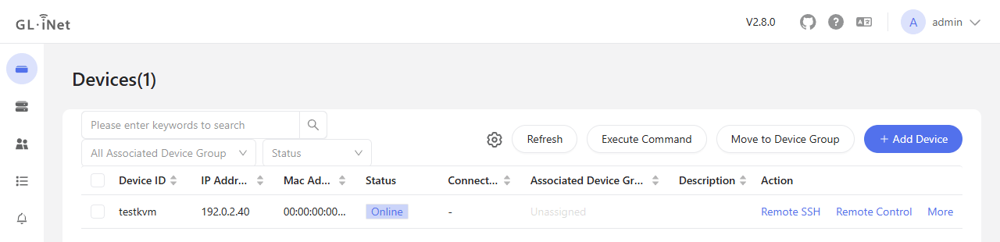

# GLKVM Relay for Home Assistant

A Home Assistant app that runs GL.iNet's self-hosted GLKVM Cloud relay (`rttys`) and a TURN server (coturn) on the Home Assistant host, so the GL.iNet KVMs on your network are reached through one web console with no separate server. Credentials are generated on the first start and the TURN server learns each KVM's address when it registers, so nothing has to be typed.

| App | What |
|---|---|
| [GLKVM Relay](glkvm_relay/) | GLKVM Cloud relay and its TURN server on the host network, with generated credentials, TURN peers learned from the KVMs, and a TURN credential you replace by raising one option. |

## Screenshots



The web console the app serves, listing a registered KVM.

## Installing

[](https://my.home-assistant.io/redirect/supervisor_add_addon_repository/?repository_url=https%3A%2F%2Fgithub.com%2Fheidrickla%2Fha-glkvm-relay)

[](https://my.home-assistant.io/redirect/supervisor_addon/?addon=2ee9e8b9_glkvm_relay&repository_url=https%3A%2F%2Fgithub.com%2Fheidrickla%2Fha-glkvm-relay)

The first button adds this repository to the App Store; the second opens the app's page. Without My Home Assistant: Settings > Apps > App Store > the three-dot menu > Repositories, add `https://github.com/heidrickla/ha-glkvm-relay`, then install GLKVM Relay. The app runs on amd64 and aarch64.

## Setup

1. Install GLKVM Relay and start it. No option needs to be typed.
2. Open the app's Configuration tab and note the admin password generated on the first start.
3. Select Open Web UI and sign in as `admin` with that password.
4. For each KVM: in the web console, add a device, copy the script it shows, and run it in the KVM's terminal. The KVM appears in the device list, and TURN may relay to it from then on.

## Options

Only the two credentials are shown by default; the rest have working defaults and appear under the unused optional options. Details are in [glkvm_relay/DOCS.md](glkvm_relay/DOCS.md).

| Option | Default | Use |
|---|---|---|
| `password` | generated | Admin password for the web console. |
| `device_token` | generated | Token a KVM presents to join the relay. |
| `admin_name` | `admin` | Administrator account name. |
| `access_ip` | the host's address on its default route | Address browsers and KVMs use to reach the relay. |
| `web_port`, `proxy_port`, `device_port`, `turn_port` | `443`, `10443`, `5912`, `3478` | Ports on the host network. |
| `turn_learn_peers` | on | TURN may relay to the address each registered KVM connected from. |
| `turn_allowed_peers` | none | More private IPv4 addresses or ranges TURN may relay to. |
| `turn_secret_generation` | `1` | Raise and restart to replace the TURN credential. |
| `certfile`, `keyfile` | `fullchain.pem`, `privkey.pem` | Certificate pair in `/ssl`; a self-signed one is used without them. |

## Developing

```bash
python -m pip install ruff yamllint shellcheck-py
ruff check . && ruff format --check .
shellcheck glkvm_relay/run.sh tests/turn_rotation_test.sh tests/turn_peers_test.sh tests/run_image.sh
bash tests/turn_rotation_test.sh
docker buildx build --load --platform linux/amd64 --build-arg BUILD_ARCH=amd64 -t glkvm-relay:dev glkvm_relay
docker buildx build --load --platform linux/arm64 --build-arg BUILD_ARCH=aarch64 -t glkvm-relay:dev-aarch64 glkvm_relay
bash tests/run_image.sh glkvm-relay:dev
python tests/relay_probe.py <relay host>
```

`tests/turn_rotation_test.sh` needs bash, jq and openssl. `tests/run_image.sh` starts the image with only the two credentials set, probes it, runs `tests/turn_peers_test.sh` inside it, and checks that TURN relays to a private peer only once a KVM has registered from it. `tests/relay_probe.py` checks a running relay from the network: the web console, the device and proxy ports, and a STUN answer.

## Licence

MIT for this repository's files; see `LICENSE`. GLKVM Cloud is GL.iNet's work under the Business Source License 1.1, which permits non-production use, including personal use, and becomes GPLv3 on 2030-01-01. The image builds `rttys` from GL.iNet's published source at a pinned commit when it is built, and this repository includes none of their code. GL.iNet and GLKVM are GL.iNet's names; this project is not affiliated with GL.iNet.
